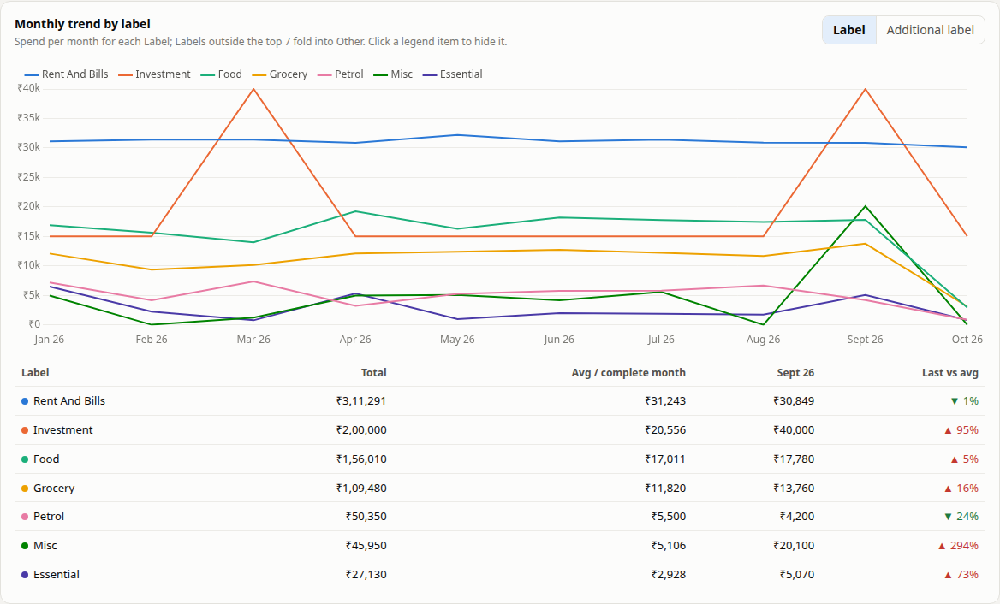
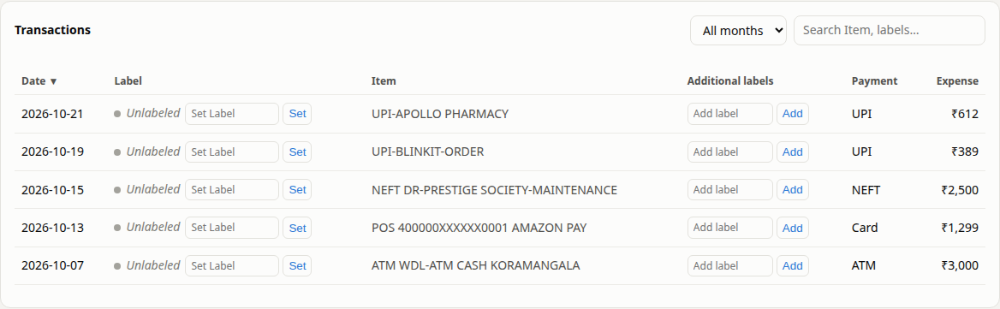

# Expense tracker: Google Sheets → SQLite → dashboard

[](https://github.com/karanrn/expense-tracker/actions/workflows/test.yml)

Keep your expenses in a yearly Google Sheet (`Expenses 2026`, one tab per month), and this tool imports them into a local SQLite database and shows them in a searchable dashboard. Bank statements can be imported too, and matched against what you already entered in the sheet.

- **Sync** every yearly workbook incrementally, without duplicating rows on repeat runs.
- **Import bank statements** (`.xls`, `.xlsx`, `.txt`, `.csv`) from any bank. Withdrawals the sheet already records are skipped.
- **Explore** your spending with monthly totals, a trend per Label, breakdowns, search and filters.
- **Label** transactions with your own extra tags, and give a Label to bank rows that have none.
- **Budget** per Label per month, and see which Labels are over budget.

Everything stays on your machine. Defaults are set for India (`₹`, day-first dates), and both can be changed in `config.toml`.

[](docs/expense-tracker-demo.mp4)

[Watch the 107-second walkthrough (MP4)](docs/expense-tracker-demo.mp4): sync, statement import, labels and budgets from the command line, then a tour of the dashboard.

| Budgets per Label | Monthly trend per Label |
|---|---|
|  |  |
| **Searchable transactions with additional labels** | **Bank-statement rows waiting for a Label** |
|  |  |

_The video and screenshots use made-up data._

## Quickstart

You need Python 3.11 or newer.

```bash
git clone https://github.com/karanrn/expense-tracker && cd expense-tracker
python -m pip install -r requirements.txt
```

To try it without Google, point `config.toml` at a local copy of the template. Set `[source] type = "file"` and `file_path = "Template - Expenses 2026.xlsx"`, add a few rows, then run:

```bash
make dry-run    # preview what would be imported
make run        # import, then open the dashboard at http://127.0.0.1:8765
```

## Your sheet

Each month tab needs these columns. Header matching ignores case, and a unit suffix like `Expense(INR)` still counts:

| Date | Expense | Item | Label |
|---|---:|---|---|
| 1/2 | 450 | Coffee and sandwich | Food |

[`Template - Expenses 2026.xlsx`](Template%20-%20Expenses%202026.xlsx) has this layout, with twelve month tabs (`Jan26` … `Dec26`), a Label dropdown, per-month totals in columns F–G, and a yearly `Summary` tab. To use it, upload it to Google Drive, open it, choose **File → Save as Google Sheets** (the formulas need Sheets), and name it `Expenses 2026`.

- **Ignored rows and tabs:** side panels, totals, zero-amount rows and the `Summary` tab (`skip_worksheets`) are never imported.
- **Dates without a year:** dates written `M/D` take their year from the workbook title.
- **Unreadable rows:** rows that look like expenses but won't parse go to `parse_failures.csv`.
- **Labels:** these are free text. Add new ones to the dropdown and the F–G formulas if you want the totals inside the sheet to include them.
- **Other column names:** map your own headers under `[columns]` in `config.toml`.

## Connecting Google Sheets

1. **Create the OAuth client:** in a Google Cloud project, enable the **Google Sheets API** and the **Google Drive API**, set up the OAuth consent screen, and create an **OAuth client ID** of type **Desktop app**.
2. **Point the config at it:** save the downloaded JSON in the project folder and set `oauth_client_json` to its filename. The default is `service_account.json`, but this is an OAuth client file, not a service-account key.
3. **Share and sync:** share each `Expenses YYYY` sheet with your Google account as a Viewer, then run `make sync`. The first run opens a browser to authorize access (read-only), and the token is cached in `authorized_user.json`.

New yearly sheets are found automatically by title (`spreadsheet_title_pattern`). To narrow discovery, use `folder_id`; to read one workbook directly, use `sheet_id`.

The OAuth client file and the token are gitignored. Never commit or share them. If they leak, revoke the client in Google Cloud and authorize again.

**Other sources.** These are set under `[source]` in `config.toml`:
- `type = "file"` reads a local `.xlsx` or `.csv` file.
- `type = "gsheet_csv"` reads a publicly viewable sheet through `sheet_url`, with no credentials.

## Usage

All commands run through `python -m expense_tracker …`. The Makefile targets wrap the common ones (`make help` lists them), and `make run PYTHON=.venv/bin/python` picks the interpreter.

### Sync

```bash
make sync                                       # incremental: from the latest date already stored
python -m expense_tracker sync --dry-run        # preview, write nothing
python -m expense_tracker sync --full-rescan    # pick up late entries with older dates
python -m expense_tracker sync --mirror         # also delete rows that are no longer in the sheet
```

- **Repeat syncs:** running a sync again never duplicates rows, and identical same-day transactions are kept separately.
- **Edited rows:** an edited sheet row is imported as a new row, and the old one stays. Use `--mirror` only when the sheet is the complete record for its date range, because mirror deletes rows that are gone from the sheet, along with their additional labels.

### Bank statements

```bash
python -m expense_tracker sync --statement statements/Acct_Statement_2026-10.xls
make statement FILES='statements/*.txt'
```

- **What's imported:** only withdrawals. Each becomes an expense with the narration as Item, the channel (UPI, Card, NEFT, …) as Payment, and no Label.
- **Duplicates:** the same transaction is never stored twice, even across overlapping statements or the `.xls` and `.txt` exports of one statement.
- **Matching the sheet:** a withdrawal with the same date and whole-rupee amount as a sheet row is treated as that row, and the sheet wins. If the statement came first, the next sheet sync replaces the bank row.
- **Headers:** column names are recognized across banks (`Txn Date`, `Narration`/`Particulars`, `Withdrawal Amt.`/`Debit`, a single signed `Amount`, …). If a statement is still rejected, the error shows the closest header row; name its columns under `[statements.columns]`.

`statements/` and spreadsheet files are gitignored, so keep statements there.

### Labels and budgets

Additional labels are your own tags and leave the sheet's Label unchanged. A Label can only be set on rows that have none, such as bank imports.

```bash
python -m expense_tracker labels add Work --source-label Food --item-contains coffee
python -m expense_tracker labels set-primary Food --item-contains swiggy --from 2026-04-01
python -m expense_tracker labels list

python -m expense_tracker budgets set Food 8000                      # every month
python -m expense_tracker budgets set Travel 25000 --month 2026-12   # overrides one month
python -m expense_tracker budgets list --month 2026-09
```

Label matching ignores case, and Item matching is a case-insensitive substring search. In the dashboard, budgets count every expense in the month, whatever filters are set.

### Dashboard

- **`make serve`** runs the editable dashboard at `http://127.0.0.1:8765`. You can add or remove labels, set missing Labels and edit budgets there, and changes save to SQLite immediately. The server only answers requests for localhost and from its own page, so other websites can't read or change your data. Keep it bound to localhost.
- **`make report`** writes a standalone, view-only `dashboard.html` snapshot.

### Scheduling

```cron
0 23 * * * cd /path/to/expense-tracker && python3 -m expense_tracker sync >> sync.log 2>&1
```

### Querying the database

`expenses.db` is a plain SQLite file. In it, `category` holds the Label and `description` holds the Item.

```sql
SELECT month, category AS label, ROUND(SUM(amount), 2) AS spent
FROM expenses GROUP BY month, category ORDER BY month, spent DESC;
```

The tables are:
- `expenses`, with `origin` set to `sheet` or `bank`
- `expense_labels`
- `budgets`
- `sync_runs`

To back the database up, copy it while nothing is running, or use `sqlite3 expenses.db ".backup copy.db"`.

## Development

```bash
make test       # standard-library unittest suite; needs no network or credentials
pip install -e .   # optional: adds an `expense-tracker` command
```

The code is in `expense_tracker/`, one module per stage. The pipeline runs `sources` → `parsing` → `sync` → `db` → `report`/`server`, and `statements` imports bank statements. [CLAUDE.md](CLAUDE.md) explains the architecture and its invariants, such as row identity, the two origins and schema migrations. The top-level `sync.py`, `serve.py`, `report.py` and `labels.py` are thin shims kept for older commands.

`make media` re-records the video and screenshots from made-up data (`docs/media/`). It needs Node.js and `ffmpeg`, and takes about two minutes.

## License

[MIT](LICENSE)
