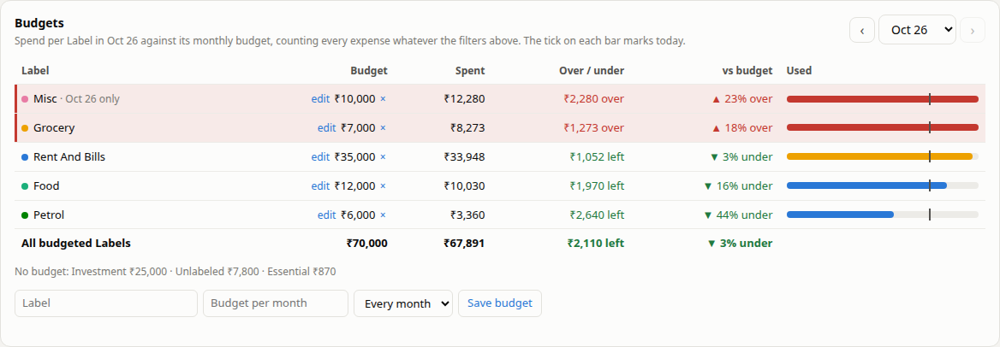

# Expense tracker: Google Sheets → SQLite → dashboard

[](https://github.com/karanrn/expense-tracker/actions/workflows/test.yml)

Keep your expenses in a yearly spreadsheet (`Expenses 2026`, one tab per month), in Google Sheets or as a local `.xlsx`. This tool imports them into a local SQLite database and shows them in a searchable dashboard. Bank statements can be imported too, and matched against what you already entered in the sheet.

- **Sync** every yearly workbook incrementally, without duplicating rows on repeat runs.
- **Import bank statements** (`.xls`, `.xlsx`, `.txt`, `.csv`) from any bank. Withdrawals the sheet already records are skipped, and deposits can be kept as income.
- **Explore** your spending with monthly totals, a trend per Label, breakdowns, search, filters and CSV export.
- **Label** transactions with your own extra tags, give a Label to bank rows that have none, or let keyword rules do it.
- **Budget** per Label per month, and see which Labels are over budget.

Everything stays on your machine, and the dashboard works offline. India (`₹`, `1,00,000`, day-first dates), the US, the UK and the euro area each have a preset, and any other currency and format can be set in `config.toml`.

[](docs/expense-tracker-demo.mp4)

[Watch the 108-second walkthrough (MP4)](docs/expense-tracker-demo.mp4): sync, statement import, labels and budgets from the command line, then a tour of the dashboard.

| Budgets per Label | Monthly trend per Label |
|---|---|
|  |  |
| **Searchable transactions with additional labels** | **Bank-statement rows waiting for a Label** |
|  |  |

_The video and screenshots use made-up data._

## Quickstart

You need Python 3.11 or newer. The commands are the same on Linux, macOS and Windows. Where these docs say `python`, use whatever runs Python 3 on your system (`python3`, or `py` on Windows).

**1. Install.** Pick one:

```bash
pipx install sheets-expense-tracker      # then run the commands as: expense-tracker <command>
```

```bash
git clone https://github.com/karanrn/expense-tracker && cd expense-tracker
python -m pip install -r requirements.txt   # then run: python -m expense_tracker <command>
```

The rest of this README writes `python -m expense_tracker`. With pipx, type `expense-tracker` instead.

**2. Try it on made-up data.** This builds a demo project with a year of expenses and a bank statement, imports them, and opens the dashboard. Your own files are not touched.

```bash
python -m expense_tracker demo
```

**3. Set it up for your data.** `init` asks where your expenses are and which currency format you use, then writes `config.toml`. If you choose a local file, it also writes this year's workbook from the template, so you can start entering expenses right away.

```bash
python -m expense_tracker init      # or non-interactively: init --source file --region us
python -m expense_tracker doctor    # checks the config, credentials and source, and says what to fix
python -m expense_tracker sync      # import into SQLite
python -m expense_tracker serve     # the dashboard at http://127.0.0.1:8765
```

`init` writes `./config.toml`, and commands run from that folder find it. To run the commands from any folder, use `init --global`, which writes the config to `~/.config/expense-tracker/` (or `%APPDATA%\expense-tracker` on Windows). You can also point `$EXPENSE_TRACKER_CONFIG` or `--config` at a config anywhere.

## Your sheet

Each month tab needs these columns. Header matching ignores case, and a unit suffix like `Expense(INR)` still counts:

| Date | Expense | Item | Label |
|---|---:|---|---|
| 1/2 | 450 | Coffee and sandwich | Food |

`python -m expense_tracker template --year 2026` writes `Expenses 2026.xlsx` in this layout. It has twelve month tabs (`Jan26` … `Dec26`), a Label dropdown, per-month totals in columns F–G, and a yearly `Summary` tab. Run it again with next year's number each January.

- **Local file:** keep the workbook wherever `file_path` points. The default, `Expenses *.xlsx`, reads one workbook per year.
- **Google Sheets:** upload the workbook to Drive, open it, choose **File → Save as Google Sheets** (the formulas need Sheets), and name it `Expenses 2026`.

How rows are read:

- **Ignored rows and tabs:** side panels, totals, zero-amount rows and the `Summary` tab (`skip_worksheets`) are never imported.
- **Dates without a year:** dates written `M/D` take their year from the workbook title.
- **Unreadable rows:** rows that look like expenses but won't parse go to `parse_failures.csv`.
- **Labels:** these are free text. Add new ones to the dropdown and the F–G formulas if you want the totals inside the sheet to include them.
- **Other column names:** map your own headers under `[columns]` in `config.toml`.

## Connecting Google Sheets

There are three sources, set by `[source] type` in `config.toml`:

- `file` reads a local `.xlsx` or `.csv`. You don't need a Google account.
- `gsheet_csv` reads a sheet shared as "Anyone with the link can view", through `sheet_url`. You don't need credentials, but anyone with the link can see your expenses.
- `gsheet_api` reads your private yearly sheets, found by title. Setting it up takes about ten minutes, once:

1. **Create a Google Cloud project** at [console.cloud.google.com](https://console.cloud.google.com/), and enable the **Google Sheets API** and the **Google Drive API** for it.
2. **Set up the OAuth consent screen**. Choose the **External** user type and fill in the required fields. While the app is in **Testing**, add your own Google account under **Test users**, or sign-in will be refused.
3. **Publish the app** (Audience or OAuth consent screen → **Publish app**). In Testing mode, Google expires the sign-in after 7 days, so scheduled syncs would start failing every week. Personal use with these read-only scopes needs no verification. Google shows an "unverified app" warning on first sign-in, which you can click through for your own app.
4. **Create an OAuth client ID** of type **Desktop app**, download its JSON, and save it next to `config.toml` as `oauth_client.json` (or set `oauth_client_json`).
5. **Sync.** Run `python -m expense_tracker doctor`, then `python -m expense_tracker sync`. The first sync opens a browser to authorize read-only access, and the token is cached in `authorized_user.json`.

New yearly sheets are found automatically by title (`spreadsheet_title_pattern`). To narrow discovery, use `folder_id`. To read one workbook directly, use `sheet_id`.

The OAuth client file and the token are gitignored. Never commit or share them. If they leak, delete the client in Google Cloud and authorize again. If sync says the token has expired or been revoked, delete `authorized_user.json` and sync again.

## Usage

Run `python -m expense_tracker --help` to see every command, and `python -m expense_tracker <command> --help` for one command's options. In a clone, the Makefile has shortcuts (`make help` lists them; `make run PYTHON=.venv/bin/python` picks the interpreter). On Windows, run the commands directly.

### Sync

```bash
python -m expense_tracker sync                  # incremental: from the latest date already stored
python -m expense_tracker sync --dry-run        # preview, write nothing
python -m expense_tracker sync --full-rescan    # pick up late entries with older dates
python -m expense_tracker sync --mirror         # also delete rows that are no longer in the sheet
```

- **Repeat syncs:** running a sync again never duplicates rows, and identical same-day transactions are kept separately.
- **Edited rows:** an edited sheet row is imported as a new row, and the old one stays. Use `--mirror` only when the sheet is the complete record for its date range, because mirror deletes rows that are gone from the sheet, along with their additional labels.

### Bank statements

```bash
python -m expense_tracker sync --statement statements/Acct_Statement_2026-10.xls
python -m expense_tracker sync --statement statements/*.csv --dry-run
```

- **What's imported:** withdrawals. Each becomes an expense with the narration as Item, the channel (UPI, Card, NEFT, ACH, ATM, …) as Payment, and no Label, unless a [rule](#labels-rules-and-budgets) matches.
- **Income:** set `import_deposits = true` under `[statements]` to also keep deposits (salary, refunds) as income. The dashboard then shows income against spending per month.
- **Duplicates:** the same transaction is never stored twice, even across overlapping statements or the `.xls` and `.txt` exports of one statement.
- **Matching the sheet:** a withdrawal with the same date and amount (to the whole unit) as a sheet row is treated as that row, and the sheet wins. If the statement came first, the next sheet sync replaces the bank row.
- **Headers:** column names are recognized across banks (`Txn Date`, `Narration`/`Particulars`/`Description`, `Withdrawal Amt.`/`Debit`/`Money Out`, a single signed `Amount`, …). If a statement is rejected or read wrongly, `--show-headers` shows what was recognised. Name the missing columns under `[statements.columns]`, or [open an issue](https://github.com/karanrn/expense-tracker/issues/new/choose) with that output. It masks the transaction data, so it is safe to share.

```bash
python -m expense_tracker sync --statement statement.csv --show-headers
```

`statements/` and spreadsheet files are gitignored, so keep statements there.

### Labels, rules and budgets

Additional labels are your own tags and leave the sheet's Label unchanged. A Label can only be set on rows that have none, such as bank imports.

```bash
python -m expense_tracker labels add Work --source-label Food --item-contains coffee
python -m expense_tracker labels set-primary Food --item-contains swiggy --from 2026-04-01
python -m expense_tracker labels list
```

**Rules** set Labels automatically. Under `[rules]` in `config.toml`, map a Label to words found in the Item:

```toml
[rules]
Food = ["swiggy", "zomato"]
Petrol = ["fuel", "hpcl"]
"Rent and bills" = ["bescom", "act fibernet"]
```

Rules run after every sync and statement import, and only on expenses without a Label. Matching ignores case, and the first matching rule wins. To apply new rules to rows already stored, run `python -m expense_tracker labels apply-rules` (add `--dry-run` to preview).

**Budgets** are monthly, per Label:

```bash
python -m expense_tracker budgets set Food 8000                      # every month
python -m expense_tracker budgets set Travel 25000 --month 2026-12   # overrides one month
python -m expense_tracker budgets list --month 2026-09
```

Label matching ignores case, and Item matching is a case-insensitive substring search. In the dashboard, budgets count every expense in the month, whatever filters are set.

### Dashboard

- **`python -m expense_tracker serve`** runs the editable dashboard at `http://127.0.0.1:8765`. You can add or remove labels, set missing Labels and edit budgets there, and changes save to SQLite immediately. The server only answers requests for localhost and from its own page, so other websites can't read or change your data. Keep it bound to localhost.
- **`python -m expense_tracker report`** writes a standalone, view-only `dashboard.html` snapshot. It's a single file that works offline.
- **Download CSV**, above the transactions table, saves the transactions that match the current filters, search and month.

### Other currencies and formats

`init --region` sets these for you (`in`, `us`, `uk` or `eu`), and you can change them in `config.toml` at any time:

```toml
[parsing]
date_formats = ["%m/%d/%Y", "%Y-%m-%d"]   # tried in order; put your convention first
currency_symbol = "$"                     # shown in the dashboard, ignored when reading amounts
currency_code = "USD"                     # also ignored when reading amounts
decimal_separator = "."                   # "," reads 1.234,56

[display]
locale = "en-US"                          # number and month formatting in the dashboard

[statements]
date_formats = ["%m/%d/%Y"]               # your bank's date format, if it's month-first
```

`date_formats` uses Python's [strptime codes](https://docs.python.org/3/library/datetime.html#format-codes). Without them, statements are read day-first.

### Scheduling

To sync every night, run `sync` from your system's scheduler. If you installed with pipx, use the full path that `which expense-tracker` (or `where expense-tracker`) prints. Otherwise, run `python -m expense_tracker` from the clone.

**Linux (cron):** run `crontab -e` and add:

```cron
0 23 * * * cd /path/to/expense-tracker && python3 -m expense_tracker sync >> sync.log 2>&1
```

**macOS (launchd):** save this as `~/Library/LaunchAgents/local.expense-tracker.plist`, then run `launchctl load ~/Library/LaunchAgents/local.expense-tracker.plist`:

```xml
<?xml version="1.0" encoding="UTF-8"?>
<!DOCTYPE plist PUBLIC "-//Apple//DTD PLIST 1.0//EN" "http://www.apple.com/DTDs/PropertyList-1.0.dtd">
<plist version="1.0"><dict>
  <key>Label</key><string>local.expense-tracker</string>
  <key>WorkingDirectory</key><string>/Users/you/expense-tracker</string>
  <key>ProgramArguments</key><array>
    <string>/usr/bin/python3</string><string>-m</string><string>expense_tracker</string><string>sync</string>
  </array>
  <key>StartCalendarInterval</key><dict><key>Hour</key><integer>23</integer><key>Minute</key><integer>0</integer></dict>
  <key>StandardOutPath</key><string>/Users/you/expense-tracker/sync.log</string>
  <key>StandardErrorPath</key><string>/Users/you/expense-tracker/sync.log</string>
</dict></plist>
```

**Windows (Task Scheduler):** in PowerShell, run:

```powershell
$action = New-ScheduledTaskAction -Execute "py" -Argument "-m expense_tracker sync" -WorkingDirectory "C:\path\to\expense-tracker"
Register-ScheduledTask -TaskName "Expense tracker sync" -Action $action -Trigger (New-ScheduledTaskTrigger -Daily -At 11pm)
```

The first Google sign-in opens a browser, so run one `sync` by hand before scheduling it.

### Backups and querying

```bash
python -m expense_tracker backup                         # backups/expenses-<date>-<time>.db next to the DB
python -m expense_tracker backup --out ~/Dropbox/expenses.db
```

`backup` is safe to run while `sync` or `serve` is running.

`expenses.db` is a plain SQLite file. In it, `category` holds the Label and `description` holds the Item.

```sql
SELECT month, category AS label, ROUND(SUM(amount), 2) AS spent
FROM expenses GROUP BY month, category ORDER BY month, spent DESC;
```

The tables are:
- `expenses`, with `origin` set to `sheet` or `bank`
- `expense_labels`
- `budgets`
- `income` (statement deposits, with `import_deposits`)
- `sync_runs`

## Troubleshooting

Start with `python -m expense_tracker doctor`. It names the config it found, checks each setting, reads the source, and says what to change. Other common problems:

- **"No config.toml found":** run `init`, or pass `--config`.
- **Rows missing after a sync:** look in `parse_failures.csv` for the reason. It is usually a date format to add to `date_formats`, or a `decimal_separator` that doesn't match your sheet.
- **Rows with older dates missing:** syncs are incremental from the latest date already stored. Run `sync --full-rescan`.
- **The Google sign-in expires every week:** publish the OAuth app (step 3 of [Connecting Google Sheets](#connecting-google-sheets)).

## Upgrading

From a clone, run `git pull` and then `pip install -r requirements.txt`. With pipx, run `pipx upgrade sheets-expense-tracker`. Existing databases are migrated automatically. See [CHANGELOG.md](CHANGELOG.md) for what changed.

**Upgrading a clone from 0.1:** `config.toml` is no longer tracked in git, so `git pull` deletes it. Copy it somewhere safe first, and copy it back after pulling.

## Development

```bash
pip install -e .   # adds the `expense-tracker` command, using this checkout
make test          # standard-library unittest suite; needs no network or credentials
```

The code is in `expense_tracker/`, one module per stage. The pipeline runs `sources` → `parsing` → `sync` → `db` → `report`/`server`, and `statements` imports bank statements. [CONTRIBUTING.md](CONTRIBUTING.md) covers setup, the rules that keep existing databases working, adding a bank, and releasing. [CLAUDE.md](CLAUDE.md) explains the architecture in more depth. The top-level `sync.py`, `serve.py`, `report.py` and `labels.py` are thin shims kept for older commands.

`make media` re-records the video and screenshots from made-up data (`docs/media/`). It needs Node.js and `ffmpeg`, and takes about two minutes.

## License

[MIT](LICENSE). The dashboard bundles [Chart.js](https://www.chartjs.org/) (MIT).
