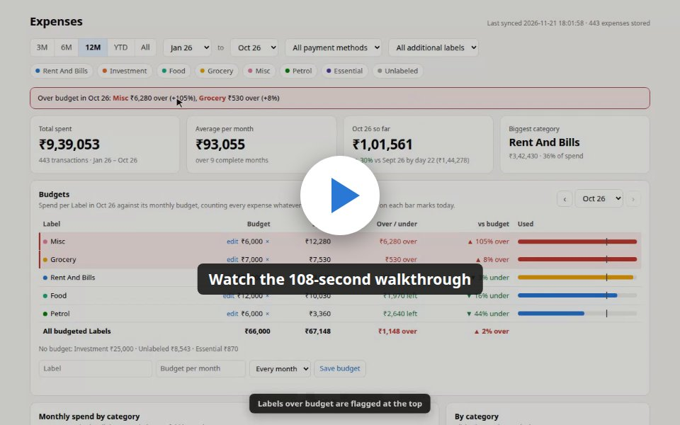
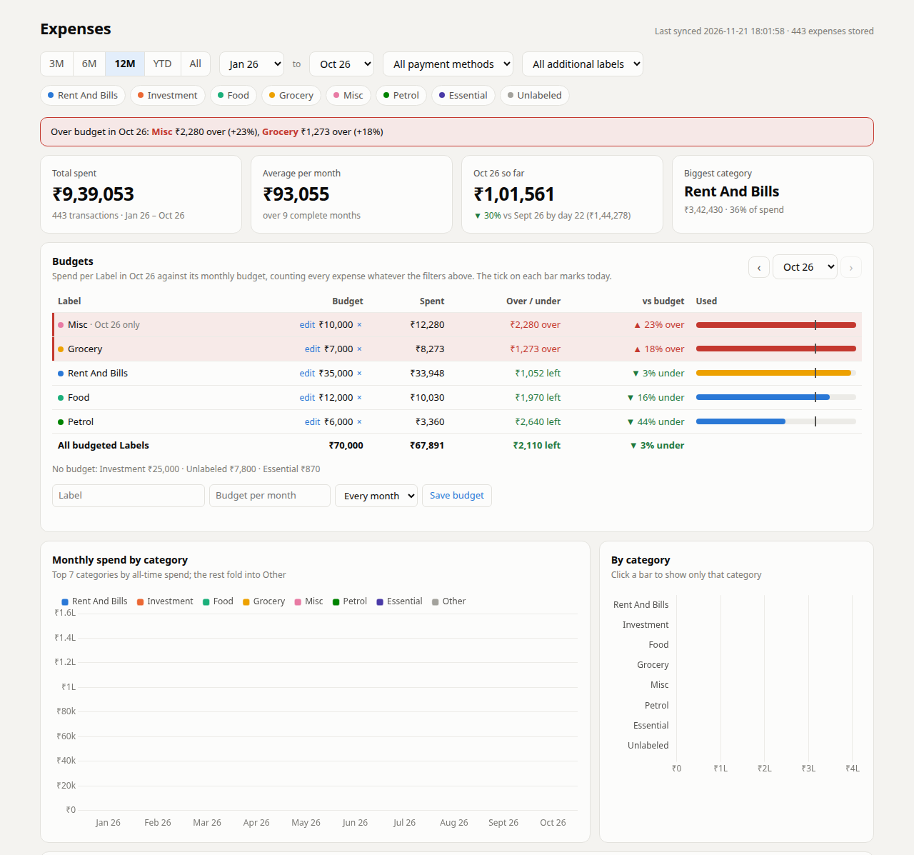
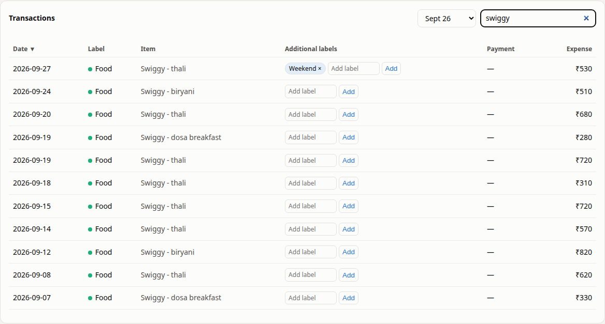

# Expense tracker: Google Sheets → SQLite → dashboard

This project imports all accessible yearly Google spreadsheets whose titles match `Expenses YYYY` (for example, `Expenses 2025`), with one expense worksheet per month, into a durable SQLite database and builds a searchable dashboard.

- `sync.py` reads every monthly worksheet through the Google Sheets API by default, imports transactions, and skips summary/formula rows that do not match the expense columns. If API access is unavailable, it attempts to download the whole spreadsheet as XLSX and parse all tabs (requires the spreadsheet to be publicly viewable).
- `sync.py --statement FILE…` imports withdrawals from bank account statements (HDFC-style `.xls` or comma-delimited `.txt`) without a Label, skipping ones already stored or already entered in the sheet. See [Bank statements](#bank-statements).
- `report.py` builds `dashboard.html` with monthly totals, a monthly trend per Label or additional label, Label and payment breakdowns, a searchable transaction list with a month picker, and date/Label/payment/additional-label filters.
- `serve.py` runs the dashboard locally with controls to add/remove additional labels on each transaction; changes are written to SQLite immediately.
- `labels.py` attaches your own extra labels to transactions without changing the workbook’s existing Label values.

### Walkthrough video

[](docs/expense-tracker-demo.mp4)

[Watch the 85-second walkthrough (MP4)](docs/expense-tracker-demo.mp4). It runs `make dry-run`, `make sync`, `labels.py` and `make serve`, then tours the dashboard: date ranges, Label filters, the monthly trend, transaction search, and adding and filtering by additional labels.

### Screenshots



| Monthly trend per Label | Searchable transactions with additional labels |
|---|---|
|  |  |

_Screenshots use made-up data entered into the [template](#google-sheet-template)._

The expected transaction columns on each month sheet are:

| Date | Expense | Item | Label |
|---|---:|---|---|
| 2025-01-02 | 450 | Coffee and sandwich | Food |

Header unit suffixes such as `Expense(INR)` are accepted as `Expense`. Sheets API dates formatted as `M/D` without a year are interpreted as month/day and get the year from the parent `Expenses YYYY` spreadsheet. Worksheets named in `source.skip_worksheets` (default `Summary`) are not read. Side panels next to the expense columns (such as a monthly `Total` cell) are ignored, so the expense on the same row is still imported. Zero-amount rows are skipped. Rows that look like expenses but have an unreadable date or amount are written to `parse_failures.csv` (`parsing.failures_log`), which is overwritten on every sync.

## Google Sheet template

[`Template - Expenses 2026.xlsx`](Template%20-%20Expenses%202026.xlsx) is a ready-made yearly workbook in the layout `sync.py` expects. To use it:

1. In Google Drive, choose **New → File upload**, upload the template, then open it and choose **File → Save as Google Sheets**. (The month-sheet formulas use Google Sheets’ `FILTER`, so they only calculate correctly once converted.)
2. Rename the Google Sheet to `Expenses YYYY` (for example, `Expenses 2026`) so Drive discovery matches `spreadsheet_title_pattern`.
3. Share it as a Viewer with the Google account you authorize in Setup.
4. For a new year, make a copy, rename it and its tabs (`Jan27`, …), and update the tab names in the `Summary` formulas.

### Month tabs (`Jan26` … `Dec26`)

One tab per month. Columns A–D hold the transactions that get imported:

| Column | Header | What to enter |
|---|---|---|
| A | `Date` | Transaction date. The cells are formatted `m/d`; the year comes from the spreadsheet title. |
| B | `Expense(INR)` | Amount as a number. |
| C | `Item` | Free-text description (searchable in the dashboard). |
| D | `Label` | Pick from the dropdown: `Food`, `Rent and bills`, `Investment`, `Essential`, `Grocery`, `Misc`, `Petrol`. |

Columns F–G are a per-month summary panel for use inside the sheet; `sync.py` ignores them:

| Row | F | G |
|---|---|---|
| 1 | Month | Month name |
| 2 | Total | Sum of all expenses (`B2:B79`) |
| 3 | Investments | Sum where Label = `Investment` |
| 4 | Rent and bills | Sum where Label = `Rent and bills` |
| 5 | Food (Swiggy) | Sum where Label = `Food` |
| 6 | Grocery and essentials | Sum where Label = `Grocery` or `Essential` |
| 7 | Miscellaneous | Sum where Label = `Misc` |
| 8 | Petrol | Sum where Label = `Petrol` |
| 9 | Expenses | Rows 4–8, i.e. spending excluding investments |

The Label dropdown and the Total formula cover roughly the first 78 transaction rows (the per-label sums go to row 86). If a month has more entries, extend the data validation and the formula ranges.

### `Summary` tab

A yearly roll-up (cells B30:E37) built from each month tab’s G column: Total per label across all twelve months, Share % of total expenses, and Monthly Avg. Monthly Avg divides by a fixed `8`; change that divisor to the number of months elapsed. The tab is listed in `source.skip_worksheets`, so it is never imported.

### Adding or renaming labels

Labels are free text as far as `sync.py` is concerned — any value in column D is imported as the transaction’s Label and appears in the dashboard. To keep the in-sheet totals accurate, add the new value to the column D dropdown (**Data → Data validation**) on each month tab, and add matching `FILTER` rows in column F–G and in `Summary` if you want it totalled there.

## Setup

1. In the same Google Cloud project, enable both the **Google Sheets API** and the **Google Drive API**, configure the OAuth consent screen, and create an OAuth Client ID for a **Desktop app**. Drive API is used to discover spreadsheets by title. Save the downloaded client JSON in the project folder. The supplied `service_account.json` is an installed-app OAuth client file, not a service-account key or an OAuth access token.
2. Install the API client and workbook reader (Python 3.11+):
   ```bash
   python -m pip install -r requirements.txt
   ```
3. Set `oauth_client_json` to the downloaded OAuth client file and `oauth_token_json` to a writable path for the cached token (defaults to `authorized_user.json`). The first sync opens a browser for you to authorize the Google account. Share each yearly spreadsheet with that same account as a Viewer.
4. The default `spreadsheet_title_pattern` discovers every accessible spreadsheet titled `Expenses YYYY`; leave it as-is for that naming convention. Optionally set `folder_id` to limit discovery to a Drive folder. Leave `worksheet = ""` to import every month tab in every matching yearly file. If Drive title discovery is unavailable, set `sheet_id` to a specific spreadsheet ID to use Sheets API access without Drive discovery. `sheet_url` also enables public XLSX fallback for that one workbook; public sharing is required for that fallback.
5. Check parsing, import data, and build the dashboard:
   ```bash
   make dry-run
   make run
   ```

You can also run `make sync` to import without opening the UI, or `make serve` to start the dashboard against the existing database. Set `PYTHON` when needed, for example `make run PYTHON=.venv/bin/python`.

The default `config.toml` uses read-only OAuth access to Google Sheets and maps Date → date, Expense → amount, Item → transaction item/description, and Label → the existing expense label. The OAuth user token is cached locally so later syncs (including scheduled ones) can refresh authorization without a service account. New annual spreadsheets are picked up automatically when shared with the authorized Google account and titled `Expenses YYYY`. To change the naming convention, edit `spreadsheet_title_pattern`. To import a local workbook or CSV instead, change `[source].type` to `"file"`; see “Other sources” below.

`serve.py` opens the editable dashboard at `http://127.0.0.1:8765`. On each transaction, type a custom label and choose **Add**; click an existing custom-label chip to remove it. Changes are saved immediately to the configured SQLite database and reflected in the dashboard filters. Keep the server bound to localhost; it is intended for personal use.

`report.py` is the static-export alternative: it writes a standalone `dashboard.html` snapshot that can be archived, copied, or served by a static web host. It has no server/API connection, so it is view-only and label edits are disabled. `serve.py` renders the dashboard dynamically and adds the local API needed to persist label edits; you do not need to run `report.py` for normal interactive use. Use `make report` or `make report-open` when you specifically need the static snapshot.

Do not commit or share OAuth client files or the cached token. The downloaded client file is not itself the user authorization token; `gspread` writes that token to `oauth_token_json` after the first browser login. If credentials have been exposed, revoke/rotate the OAuth client in Google Cloud and authorize again.

## Durable database and restart recovery

`expenses.db` is a regular SQLite database file on disk, not temporary/in-memory storage. On startup, `sync.py` creates the configured parent directory, opens or creates the database, creates the tables and indexes, and applies additive schema changes needed by newer versions. SQLite uses a write-ahead log, foreign keys, a busy timeout, and full synchronous commits. Committed expenses and added labels therefore remain available after the script exits or the computer restarts.

Keep `expenses.db` (and, while a sync is active, its SQLite `-wal`/`-shm` files) on persistent local storage. For backups, use SQLite’s backup feature or copy the database while scripts are stopped; do not store the database in a temporary directory.

The database contains:

- `expenses`: transaction date, `month` (`YYYY-MM`), `year` (calendar year), amount, source Label, Item, optional fields, and import metadata. The year is derived from the transaction date and backfilled automatically for existing databases.
- `expense_labels`: additional labels attached to expense records; they remain separate from the workbook’s original Label.
- `sync_runs`: history and counts for each successful sync.

## Incremental sync and corrections

Every regular run reads the source and imports transactions from the **latest date already stored in the database onward**. The boundary date is included, so more expenses added on that same date are still picked up. Rows before that date are not re-imported during a regular run. On a brand-new database, the full workbook is imported.

If you add a late expense with an older date or need to rescan the full history, run:

```bash
python sync.py --full-rescan
```

Identical transactions on the same date are retained by occurrence, while repeating a sync does not duplicate them. A changed transaction is treated as a new version by default; the old version remains. `--mirror` instead rescans the full source and removes database rows within the source’s covered date range that no longer match it. Use mirror only when the source is authoritative for that whole date range; user-added secondary labels for removed transactions go away with those transactions.

`--dry-run` reports what would be inserted without writing. It may initialize an empty database/schema so the configured path can be checked, but it does not save transactions or a sync-history row.

## Bank statements

Bank account statements can be imported alongside, or instead of, the Google Sheet:

```bash
python sync.py --statement Acct_Statement_XXXXXXXX5898_15102026.xls
python sync.py --statement statements/*.txt --dry-run   # preview only
make statement FILES="statements/*.xls"
```

- **Formats:** the bank's spreadsheet export (`.xls`, needs `xlrd`, included in `requirements.txt`, or `.xlsx`) and its comma-delimited text export (`.txt`/`.csv`). The transaction header (Date, Narration, Chq./Ref.No., Value Date, Withdrawal/Debit, Deposit/Credit, Closing Balance) is found automatically; the address block, separator lines and summary are ignored.
- **What is stored:** each withdrawal becomes an expense with the narration as Item and the channel (UPI, Card, ACH, NEFT, IMPS, …) as Payment. The reference number, value date and closing balance are kept in `extra`. Deposits (salary, refunds, money received) are skipped.
- **No Label:** statement rows are stored without a Label and show as *Unlabeled* in the dashboard. Set one per transaction with the **Set Label** box in `serve.py`, or in bulk with `labels.py set-primary` (below). Only expenses without a Label can be changed this way; sheet rows keep the workbook's Label.
- **Duplicates:** a transaction is identified by its date, reference number, amount and closing balance, so the `.xls` and `.txt` exports of one statement, overlapping statements, and repeated imports never store it twice.
- **Sheet and statement together:** a withdrawal with the same date and amount (to the rupee) as a sheet row is treated as that sheet row and is not stored. If the statement was imported first, the next sheet sync replaces the matching bank row with the sheet row and moves its additional labels over. Spend the sheet records differently from the bank (one combined “SIPs” entry for several debits, a different date) cannot be matched and appears twice; give those bank rows a Label or leave them for review.

`--mirror` and `--full-rescan` apply to the sheet only; incremental sheet syncs start from the latest *sheet* date, so importing a newer statement does not hide older sheet entries.

## Add secondary labels to existing Labels

For individual transactions, use the editable dashboard described above. To bulk-assign labels from the command line, use `labels.py` without replacing the workbook Label. Match by existing Label, and optionally narrow the selection by text contained in Item and by date range:

```bash
python labels.py add Work --source-label Food --item-contains coffee
python labels.py add Reimbursable --source-label Travel --from 2025-01-01 --to 2025-12-31
python labels.py list
python labels.py remove Work --source-label Food --item-contains coffee
```

To set the Label itself on expenses that have none (bank-statement imports, or sheet rows with an empty Label), match by Item text and dates:

```bash
python labels.py set-primary Food --item-contains swiggy
python labels.py set-primary Investment --item-contains groww --from 2026-04-01
```

An existing Label matching case-insensitively keeps its spelling, so `food` joins `Food`. `labels.py list` also reports how many expenses still have no Label.

Label matching is case-insensitive; Item matching is case-insensitive substring search. Dates use `YYYY-MM-DD`. Assignments are stored in SQLite, survive restarts and later syncs, and can be selected in the dashboard’s Additional label filter. Existing workbook Labels remain unchanged.

## Search Items and query SQLite

The dashboard search box searches Item text, source Label, payment, and added labels; entering part of an Item name filters matching transactions. You can also query the database directly (with the `sqlite3` command-line program):

```sql
-- Find transactions whose Item contains “coffee” (case-insensitive)
SELECT date, amount, category AS label, description AS item
FROM expenses
WHERE instr(lower(coalesce(description, '')), 'coffee') > 0
ORDER BY date DESC;

-- Totals by month and source Label
SELECT month, category AS label, ROUND(SUM(amount), 2) AS spent
FROM expenses GROUP BY month, category ORDER BY month, spent DESC;

-- Totals by calendar year and source Label
SELECT year, category AS label, ROUND(SUM(amount), 2) AS spent
FROM expenses GROUP BY year, category ORDER BY year, spent DESC;

-- Transactions with a specific additional label
SELECT e.date, e.amount, e.category AS label, e.description AS item
FROM expenses AS e
JOIN expense_labels AS l ON l.expense_id = e.id
WHERE l.label = 'Work' COLLATE NOCASE
ORDER BY e.date DESC;

-- Recent sync history
SELECT * FROM sync_runs ORDER BY id DESC LIMIT 5;
```

## Run it periodically

On macOS/Linux, schedule sync and dashboard generation (for example, nightly at 11 pm) with `crontab -e`:

```cron
0 23 * * * cd /path/to/expense-tracker && /usr/bin/python3 sync.py && /usr/bin/python3 report.py >> sync.log 2>&1
```

On Windows, use Task Scheduler to run `python sync.py` and then `python report.py`, with the project folder as “Start in”.

## Other sources

- **CSV file:** set `type = "file"` and set `file_path` to the CSV. Update `[columns]` to match its header names.
- **Public Google Sheet without API credentials:** set `type = "gsheet_csv"` and `sheet_url` to export one tab as CSV. For the default API mode’s XLSX fallback, the spreadsheet must be publicly viewable and `sheet_id` must be configured.
- **Google Sheets API:** the default `type = "gsheet_api"` uses the OAuth Desktop client and cached user token. The authorized Google account must have Viewer access to each yearly spreadsheet. API access works for private spreadsheets; the XLSX download fallback does not.
- **Excel:** `.xlsx` and `.xlsm` files need `openpyxl` (included in `requirements.txt`). Set `type = "file"`, set `file_path`, and leave `file_sheet = ""` to scan all tabs.

To try the included CSV sample, set `type = "file"`, set `file_path = "sample_expenses.csv"`, and change the `[columns]` mappings to Date, Amount, Category, Description, Payment Method, and (if needed) Notes before syncing.

## Project layout and development

The code lives in the `expense_tracker` package, one module per job. The top-level `sync.py`, `serve.py`, `report.py` and `labels.py` are three-line shortcuts for the matching `python -m expense_tracker <command>`, so existing commands and cron jobs keep working.

```
expense_tracker/
  cli.py        command line: sync | serve | report | labels {list,add,remove}
  config.py     reads config.toml; relative paths resolve against the config file
  sources.py    Google Sheets API, public CSV/XLSX export, local .xlsx/.csv
  statements.py bank statements (.xls/.xlsx/.txt) → unlabeled withdrawal records
  parsing.py    raw rows → expense records (headers, dates, amounts, row keys)
  sync.py       incremental / full-rescan / mirror import, statement import, sheet↔bank matching
  db.py         SQLite schema, migrations, connection settings
  labels.py     additional-label operations shared by the CLI and the server
  report.py     dashboard data and HTML rendering
  server.py     local dashboard server and /api/labels
  templates/dashboard.html
tests/          unittest suite (standard library only)
```

Where to make common changes:

- **New source type:** add a reader in `sources.py` and a branch in `read_rows`.
- **New column or parsing rule:** `parsing.py`; add a case to `tests/test_parsing.py`.
- **Schema change:** `db.py`. Keep it additive and migrate existing databases in `initialize_database`, as the `year` column does.
- **Dashboard UI:** `templates/dashboard.html`; its data comes from `report.load`.

Library code raises `ExpenseTrackerError` for problems the user can fix; only `cli.py` turns those into an exit message.

Run the tests (no extra dependencies):

```bash
make test        # or: python -m unittest discover -s tests -t .
```

Optionally, `pip install -e .` adds an `expense-tracker` command (for example, `expense-tracker sync --dry-run`).
